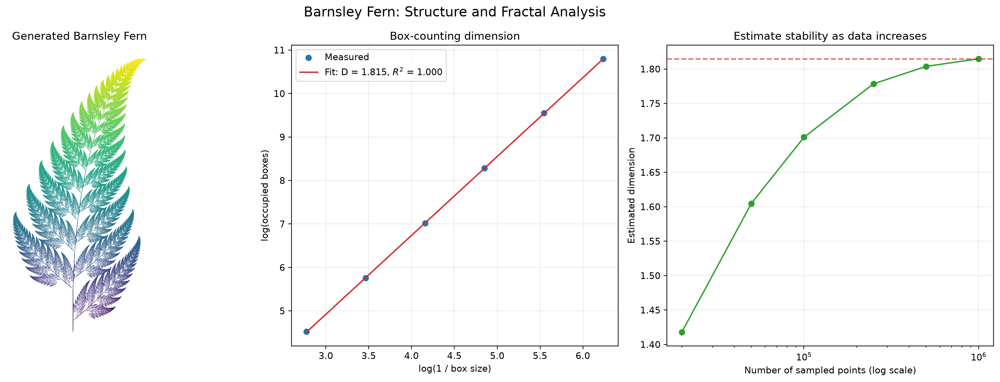

# PyTorch Barnsley Fern

This project generates a Barnsley Fern fractal with an Iterated Function
System (IFS). PyTorch tensors are used to update 20,000 independent walkers in
parallel. On Apple Silicon, the program uses the MPS device when available and
falls back to the CPU otherwise.


## How the fractal is formed

Each point `(x, y)` is transformed by one of four affine transformations. The
transformation is selected randomly using the probabilities below.

| Part of fern | Probability | New x | New y |
| --- | ---: | --- | --- |
| Stem | 1% | `0` | `0.16y` |
| Main leaflets | 85% | `0.85x + 0.04y` | `-0.04x + 0.85y + 1.6` |
| Left leaflet | 7% | `0.20x - 0.26y` | `0.23x + 0.22y + 1.6` |
| Right leaflet | 7% | `-0.15x + 0.28y` | `0.26x + 0.24y + 0.44` |

Repeated application of these transformations produces the self-similar fern
structure. The first 20 iterations are discarded to reduce the influence of
the initial point at the origin.

## How PyTorch is used

The core fractal computation is tensorised. At every iteration, PyTorch:

1. generates one random value for every walker;
2. creates Boolean masks that select the four transformations;
3. updates all selected points in parallel; and
4. runs the calculation on MPS when supported, otherwise on the CPU.

This makes PyTorch a major component of the fractal algorithm rather than using
it only for storage or plotting.

## Requirements

- Python 3.11 or a compatible Python 3 version
- PyTorch
- Matplotlib
- NumPy

Install the dependencies with:

```bash
python -m pip install -r requirements.txt
```

## Run

From the repository directory, run:

```bash
python barnsley_fern.py
```

The program displays the fractal and saves a high-resolution image to
`images/barnsley_fern.png`.

Optional arguments make the experiment reproducible and allow different
settings to be compared:

```bash
python barnsley_fern.py --walkers 20000 --steps 150 --seed 3710 --cmap viridis
```

## Fractal analysis

Run the analysis with:

```bash
python analyze_fern.py
```

The script estimates the box-counting dimension. It overlays the fern with
square grids of progressively smaller box size conceptually, counts how many
boxes contain at least one point, and fits the relationship

```text
log(number of occupied boxes) = D * log(1 / box size) + constant
```

The fitted slope `D` is the estimated fractal dimension. The script also reports
the linear fit's R-squared value and repeats the estimate with increasing point
counts. A stable estimate and a near-linear log-log relationship provide more
evidence than a single attractive image that the generated object has fractal
scaling behaviour.

The combined output is saved to `images/fractal_analysis.png` and contains:

1. the generated fern;
2. the box-counting log-log fit; and
3. the estimated dimension as the number of sampled points increases.



With seed 3710, 1,000,000 generated points, and grid sizes from 16 to 512,
the current analysis produced:

- estimated box-counting dimension: **1.8149**;
- linear-fit R-squared: **1.0000**; and
- an estimate that moves toward the final value as the sample grows.

The numerical value is an estimate, not an exact proof of dimension. It depends
on finite sampling and the selected range of box sizes. The convergence plot and
R-squared value help make those limitations visible.

## Project structure

```text
.
|-- barnsley_fern.py
|-- analyze_fern.py
|-- images/
|   |-- barnsley_fern.png
|   `-- fractal_analysis.png
|-- requirements.txt
`-- README.md
```

## AI-assisted development

AI tools were used during development. The available prompts, reconstructed
interaction summaries, suggestions, verification steps, limitations, and
student changes are documented in [AI_USAGE.md](AI_USAGE.md).

## Course approval

The lab specification asks students to seek teaching-team approval for a
fractal selected from the referenced Wikipedia list. Approval of the Barnsley
Fern should be confirmed with the demonstrator before assessment.
